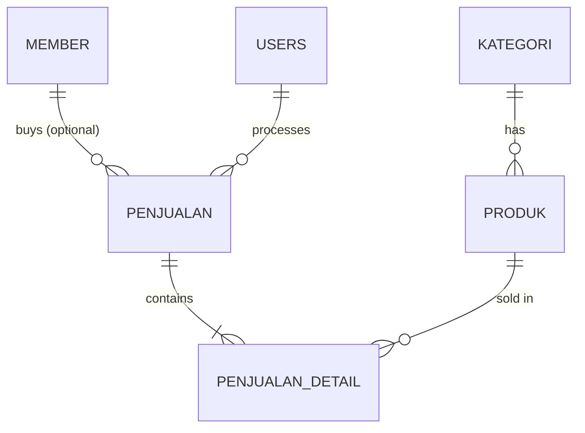
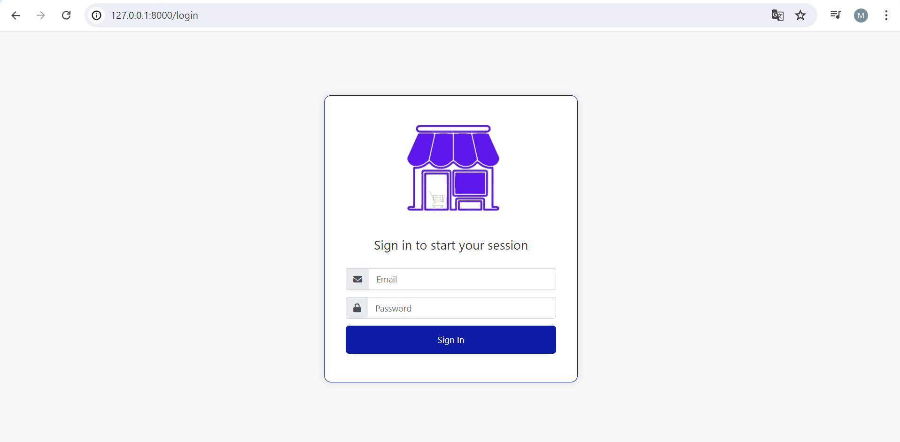
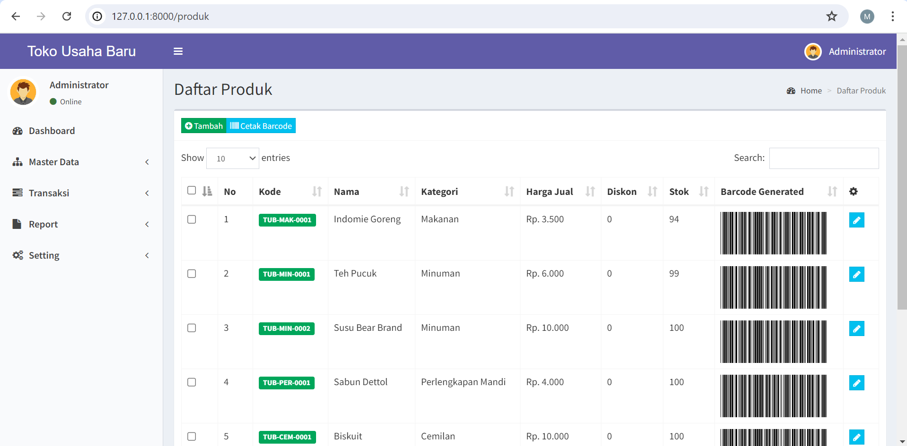
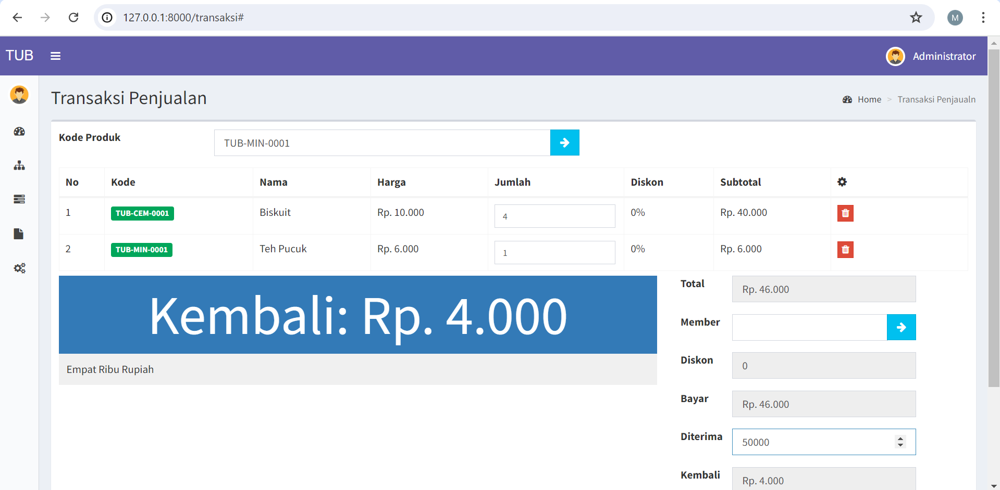
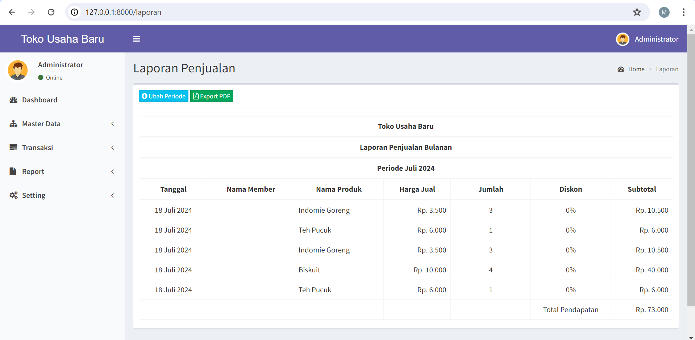
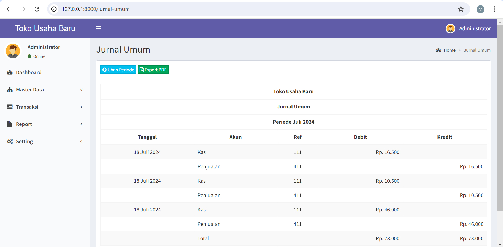
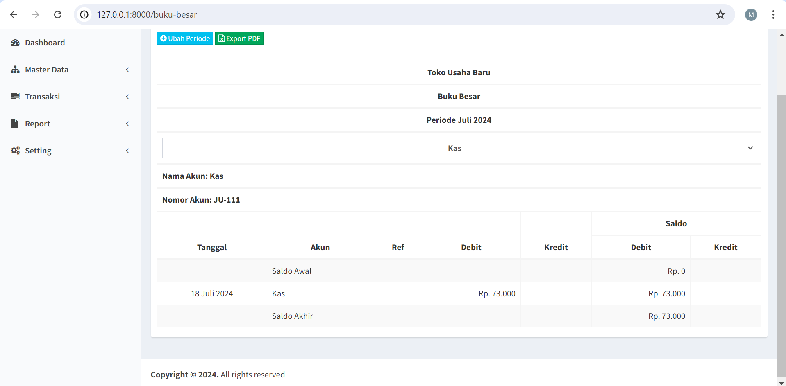

# TUB POS: Point of Sale & Accounting Reporting System

A web-based Point of Sale (POS) and accounting reporting application for **Toko Usaha Baru**, a retail store in Mojokerto, East Java. It replaces manual weekly sales recording with a transaction system that automatically produces receipts, a general journal, a general ledger and monthly sales reports.

Built as my Diploma (D3) thesis project in Accounting Information Systems, Telkom University (2024).

> **Status:** academic project, tested locally. It has not been deployed or used in production by the store.

## Features

**Administrator (level 1)**

- Dashboard with entity counts and a daily revenue chart for the current month
- CRUD for chart of accounts (COA), product categories, products, members and users
- Product barcode printing (Code 39, PDF)
- Sales history with detail view, delete and automatic stock restore
- Monthly reports exported to PDF: sales report, general journal and general ledger
- Store settings: company info, receipt type (small/large) and default member discount

**Cashier (level 2)**

- Sales transaction screen: add products, pick an optional member, apply discount, enter the amount received and see the change
- Stock is reduced automatically when a sale is saved
- Print small or large sales receipts
- Profile page

Access is controlled by a `level` middleware (`CekLevel`), so a cashier who opens an admin URL is redirected to the dashboard.

## Tech Stack

| Area     | Tools                                                          |
| -------- | -------------------------------------------------------------- |
| Backend  | PHP 8.1+, Laravel 10 (MVC), Eloquent ORM                       |
| Auth     | Laravel Jetstream / Fortify, role levels via custom middleware |
| Database | MySQL                                                          |
| Frontend | Blade, AdminLTE 2 (Bootstrap), jQuery, Yajra DataTables, Vite  |
| Reports  | barryvdh/laravel-dompdf (PDF), milon/barcode (Code 39)         |

## Database Design

Core tables: `users`, `kategori`, `produk`, `member`, `penjualan`, `penjualan_detail`, `coa` and `setting`.



`coa` (chart of accounts) and `setting` (store configuration) are standalone tables.

## Accounting Logic

Each saved sale creates a double-entry record in the general journal:

| Account           | Debit       | Credit      |
| ----------------- | ----------- | ----------- |
| Kas (cash)        | amount paid |             |
| Penjualan (sales) |             | amount paid |

The report total shows equal debit and credit. During development I checked the journal, ledger and sales report totals against manual double-entry calculations, and they matched.

## Testing

The five core modules (chart of accounts, category, product, member and sales transaction) were tested manually with black-box test cases, including invalid inputs such as empty required fields. All cases passed. The full test documentation is in the thesis book.

## Screenshots

| Login                                | Product                                  |
| ------------------------------------ | ---------------------------------------- |
|  |  |

| Sales transaction                                | Sales Report                           |
| ------------------------------------------------ | -------------------------------------- |
|  |  |

| General journal                          | Ledger                                 |
| ---------------------------------------- | -------------------------------------- |
|  |  |

## Getting Started

Requirements: PHP 8.1+, Composer, Node.js, MySQL.

```bash
git clone https://github.com/rukhulkirom/tub-pos.git
cd tub-pos

composer install
npm install

cp .env.example .env
php artisan key:generate
```

Create an empty MySQL database, then set `DB_DATABASE`, `DB_USERNAME` and `DB_PASSWORD` in `.env`.

```bash
php artisan migrate --seed   # creates tables and the default store setting
npm run build
```

Create the first administrator account (the seeder does not create users):

```bash
php artisan tinker
>>> \App\Models\User::forceCreate(['name' => 'Admin', 'email' => 'admin@example.com', 'password' => bcrypt('change-me'), 'level' => 1]);
```

Cashier accounts use `level` = 2 and can be added from the **User** menu once you are logged in as administrator.

Before recording sales, add the two accounts the journal relies on in the **COA** menu. They must be the first two rows, in this order:

1. `111` Kas
2. `411` Penjualan

Start the app:

```bash
php artisan serve
```

Open http://127.0.0.1:8000 and log in.

## Known Limitations

- The journal reads the first two COA rows as cash and sales accounts, so the account order matters (see above). A more robust design would mark these accounts explicitly.
- Only one foreign key is enforced at the database level (`produk.id_kategori`); other relations are handled in application code.
- Automated tests are limited to the default Jetstream test suite. Application-specific testing was done manually (black-box).
- Single-store scope with one revenue account; no purchasing, expenses or tax handling.

## Author

**Muhamad Rukhul Kirom**, Accounting Information Systems (D3), Telkom University
[GitHub](https://github.com/rukhulkirom) · muhamadrukhulkirom@gmail.com
